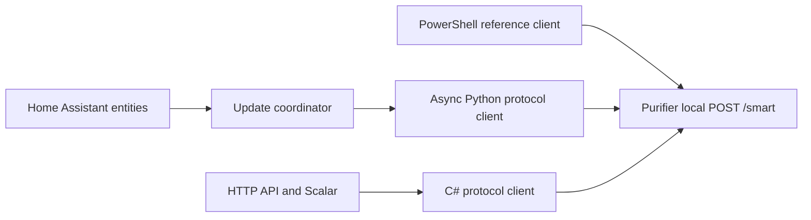

# Architecture

The repository has three independent ways to reach the same local purifier endpoint. Home Assistant uses the Python client directly. The HTTP API uses the C# client. PowerShell is a standalone reference implementation.

Each client serializes its own operations. Those locks do not coordinate separate processes or Home Assistant instances. Use one controller for a device at a time to avoid competing writes.

## Code map

| Location | Responsibility |
| --- | --- |
| `custom_components/ma_ew85s_local/protocol/` | Async HTTP, bounded XML/AES codec, validated frames, immutable state, and protocol errors; no Home Assistant imports |
| `custom_components/ma_ew85s_local/` | Config flow, coordinator, entity platforms, translations, and redacted diagnostics |
| `src/AirPurifier.Core/` | Reusable async C# protocol client and contracts |
| `src/AirPurifier.Api/` | ASP.NET Core routes, configuration, API-key handling, problem responses, OpenAPI, and Scalar |
| `ma-ew85s-reference.ps1` | PowerShell reference and offline self-test |
| `tests/python/` | Captured vectors, encrypted aiohttp simulator, protocol and HA tests |
| `tests/AirPurifier.Tests/` | C# protocol tests and in-process API tests |

Packet details belong in the [protocol specification](../MA-EW85S-local-control.md). The implementation preserves opaque settings from the freshly read frame rather than replaying complete captured commands.

## Command lifecycle

1. Acquire the client's per-device lock and read fresh status.
2. Validate the frame and expected MAC, then require supported firmware for writes.
3. Apply the operation's guards. Mode, speed, Smart Search, and cleaning require power ON; Smart Search and cleaning also require a recognized current flag.
4. If the requested state already matches, return the fresh state without writing.
5. Build and send one command changing the selected setting.
6. Wait five seconds, then request status separately. Repeat the delayed read up to three times until the requested state is confirmed.
7. Return the confirmed state, or raise an error. Release the lock in either case.

The immediate write response can contain the previous state or the target state; neither replaces the separate readback. Writes are never automatically resent. An error after a write attempt carries `command_may_have_succeeded` in Python or `CommandMayHaveSucceeded` in C#. Read fresh state before deciding whether to retry.

Readbacks also check identity, firmware, and preservation of power for non-power operations. Smart Search and cleaning additionally require the operating-mode selector to remain unchanged. Cleaning success means the cycle started; later polls report when it ends.

## Home Assistant lifecycle

The config flow reads status, requires firmware `80.00`, and stores the normalized MAC as the config entry's unique ID. Reconfiguration checks the new address against that identity.

Setup creates one client using Home Assistant's shared aiohttp session and one `DataUpdateCoordinator`. The entry's typed `runtime_data` holds both. After the first successful refresh, setup loads the fan, switch, button, binary sensor, and sensor platforms.

The coordinator polls every 30 seconds. Entity properties read its cached state and perform no I/O. Service calls use `async_run`, which publishes the returned confirmed state. Communication failures make entities unavailable, and ambiguous write failures trigger a fresh status read. Device-off errors become `ServiceValidationError`; other device write errors become `HomeAssistantError`.

The MAC also anchors device-registry connections and entity unique IDs. The signal-strength entity is diagnostic and disabled by default. Unloading removes entity listeners and polling timers; Home Assistant retains ownership of its shared HTTP session.

## Scope and verification

The local transport uses encrypted XML over HTTP. Ordinary status and setting requests do not change cloud, ECHONET, Wi-Fi, or reset settings. Those operations, discovery, louvre positioning, air quality, and filter life are outside the implemented feature set.

Hardware verification applies to the tested MA-EW85S-E and firmware `80.00`. The current Python/HA evidence is offline. See the specification's [verification matrix](../MA-EW85S-local-control.md#verification-matrix) and [evidence log](../MA-EW85S-local-control.md#11-evidence-log-and-references) for the distinction.
